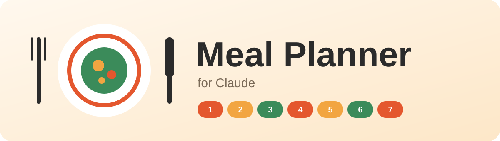
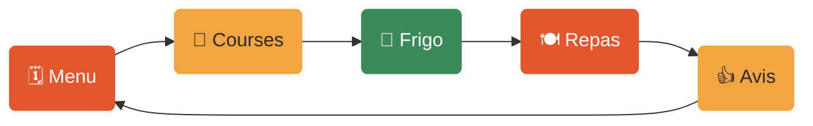

<p align="center">
  <picture>
    <source media="(prefers-color-scheme: dark)" srcset="docs/media/banner-dark.svg">
    
  </picture>
</p>

<h3 align="center">Les repas de la semaine, prévus en cinq minutes.</h3>

<p align="center">
  Claude prépare votre menu, écrit votre liste de courses, sait ce qu'il reste dans le frigo<br>
  et apprend ce que votre foyer aime. Tout reste dans votre propre Notion.
</p>

<p align="center">
  <a href="https://github.com/RandomFab/meal-planner/releases/latest/download/meal-planner.zip"></a>
  <a href="#installation"></a>
  <a href="#premier-essai"></a>
  <a href="README.en.md"></a>
</p>

<!-- GIF de démo facultatif (standard 07) : décommenter quand docs/media/demo.gif existe.
<p align="center">
  
</p>
-->

---

## Ce qu'il fait pour vous

- 🗓️ **Il prépare votre semaine.** Un menu complet, à partir des plats que vous aimez, de la saison et de ce qui est déjà dans le frigo.
- 🛒 **Il écrit votre liste de courses.** Quantités calculées depuis les recettes, sans ce que vous avez déjà, triées par magasin.
- ☀️ **Il vous dit ce qu'on mange.** Chaque matin : les plats du jour, le temps de préparation et ce qu'il faut sortir du congélateur pour demain.
- 👍 **Il apprend de vous.** Dites-lui « trop épicé » ou « on a adoré », le menu suivant en tient compte.
- 🔄 **Il s'adapte quand les plans changent.** « On sort jeudi soir » : il réorganise la semaine et vous demande avant de modifier quoi que ce soit.

## La semaine, en boucle



Chaque semaine profite de la précédente : ce que vous avez aimé revient, ce qui n'a pas plu se fait plus rare.

## Est-ce pour vous ?

| ✅ C'est pour vous si… | ❌ Ce n'est pas pour vous si… |
| --- | --- |
| Vous cuisinez à la maison la plupart des jours | Vous cherchez un suivi des calories ou un régime |
| Vous en avez assez de décider chaque soir ce qu'on mange | Vous ne prévoyez jamais plus d'un jour à l'avance |
| Vous utilisez déjà Notion, ou vous voulez bien essayer (c'est gratuit) | Vous ne voulez pas stocker vos recettes dans Notion |

## Avant de commencer

- [ ] Un compte **Claude**, sur [claude.ai](https://claude.ai) ou l'application Claude pour ordinateur. L'offre gratuite suffit ; le brief automatique du matin demande un abonnement payant (Pro ou plus).
- [ ] Un compte **Notion** gratuit, sur [notion.so](https://www.notion.so)
- [ ] Environ **10 minutes**

## Installation

### 1️⃣ Copiez le modèle Notion

Ouvrez le [modèle Meal Planner](https://example.com/notion-template) <!-- TODO : vrai lien du modèle --> et cliquez sur **Dupliquer**, en haut à droite. Vous avez maintenant votre propre copie, avec quelques plats d'exemple pour démarrer.

### 2️⃣ Connectez Notion à Claude

Dans Claude, ouvrez **Paramètres → Connecteurs**, trouvez **Notion** et cliquez sur **Connecter**. Quand Notion demande quelles pages Claude peut utiliser, choisissez **Meal Planner**.

> [!NOTE]
> Notion affiche un écran qui vous demande d'autoriser l'accès. C'est normal : Claude pourra lire et mettre à jour vos pages Meal Planner, et rien d'autre.

### 3️⃣ Activez la création de fichiers

Ouvrez **Paramètres → Capacités** et activez **Créer et modifier des fichiers**. Claude en a besoin pour utiliser les compétences.

### 4️⃣ Ajoutez Meal Planner à Claude

[Téléchargez meal-planner.zip](https://github.com/RandomFab/meal-planner/releases/latest/download/meal-planner.zip). Puis ouvrez **Personnaliser → Compétences**, cliquez sur **+**, choisissez **Télécharger une compétence** et sélectionnez le fichier. Ne le décompressez pas.

> [!TIP]
> Utilisez ce lien, pas le bouton vert **Code** de GitHub : celui-là télécharge des fichiers que Claude ne sait pas lire.

### 5️⃣ Programmez le brief du matin <sup>facultatif</sup>

Dans une nouvelle conversation, écrivez :

```text
Chaque jour à 10 h, envoie-moi le brief repas du jour.
```

Claude vous propose une tâche avec son nom, son horaire et ses instructions. Vérifiez-la, puis cliquez sur **Planifier**. Vous la retrouvez ensuite dans **Planifié**, dans la barre de gauche, pour changer l'heure ou la mettre en pause.

> [!NOTE]
> La tâche tourne même quand votre ordinateur est éteint. Elle demande un abonnement payant (Pro ou plus).

<!-- GIF d'installation facultatif (standard 07) : décommenter quand docs/media/install.gif existe.
<details>
<summary>🎬 <b>Voir toute l'installation (45 secondes)</b></summary>
<br>

</details>
-->

<details>
<summary>Vous utilisez Claude Code ?</summary>
<br>

Lancez `/plugin install meal-planner@claude-plugins` <!-- TODO : confirmer le nom du catalogue -->. Détails dans [docs/developers.md](docs/developers.md) (en anglais).
</details>

## Premier essai

Ouvrez une nouvelle conversation dans Claude et tapez :

```text
Configure mon planificateur de repas
```

Claude vous pose quelques questions (combien de personnes, quels magasins, quel jour vous faites les courses), puis se relie à votre copie Notion. Essayez ensuite :

```text
Prépare les repas de la semaine prochaine
```

Vous recevez un menu à relire. Rien n'est écrit dans Notion tant que vous n'avez pas dit que c'est bon.

## Au quotidien

| Vous dites… | Claude… |
| --- | --- |
| 🗓️ « Prépare les repas de la semaine prochaine » | Propose sept jours de repas, puis les enregistre dans Notion une fois que vous êtes d'accord |
| 🛒 « Fais la liste de courses » | Liste ce qu'il faut acheter pour la semaine, par magasin, sans ce que vous avez déjà |
| ☀️ « On mange quoi ce soir ? » | Donne les plats du jour, le temps de préparation et ce qu'il faut prévoir pour demain |
| 📸 *Une photo de recette* | Ajoute le plat et ses ingrédients à votre carnet de recettes |
| 🔄 « On sort jeudi soir » | Décale ou retire le plat de jeudi, après vous avoir demandé |
| 👎 « Le curry était trop épicé » | S'en souvient et propose ce plat moins souvent |
| 🥕 « Il n'y a plus de crème » | Met à jour ce qu'il reste et propose une solution pour les plats qui en avaient besoin |

## À votre façon

Changez ces réglages à tout moment, simplement en le disant à Claude, par exemple « On est 3 maintenant ».

| Réglage | Par défaut | Exemple |
| --- | --- | --- |
| 👥 Personnes dans le foyer | 2 | « On est 4, dont deux enfants » |
| 📅 Premier jour de la semaine | Lundi | « Notre semaine commence le mardi » |
| 🏪 Magasins | Un supermarché | « Un supermarché et un primeur » |
| 🛍️ Jour des courses | Samedi | « On fait les courses le lundi » |
| ⏰ Heure du brief du matin | 10 h | « Envoie le brief à 8 h » |

## Confidentialité et sécurité

> [!IMPORTANT]
> **Vos données restent dans votre Notion.** Meal Planner n'envoie rien ailleurs.

- ✋ **Il demande avant d'écrire.** Chaque modification de votre Notion vous est d'abord montrée.
- 🔍 **Il ne touche qu'aux pages Meal Planner** que vous avez partagées avec Claude à l'étape 2.
- 📖 **Rien de caché.** Tout ce que Claude suit est écrit en clair dans ce projet. Vous pouvez le lire.

## Questions

<details>
<summary><b>Faut-il un abonnement Claude payant ?</b></summary>
<br>
Non, Meal Planner fonctionne avec l'offre gratuite. Seul le brief automatique du matin (étape 5) demande un abonnement payant. Sans lui, demandez simplement « On mange quoi aujourd'hui ? ».
</details>

<details>
<summary><b>Claude dit qu'il ne trouve pas mes pages Notion.</b></summary>
<br>
Retournez dans <b>Paramètres → Connecteurs → Notion</b> et vérifiez que la page <b>Meal Planner</b> est bien partagée avec Claude.
</details>

<details>
<summary><b>« Télécharger une compétence » n'apparaît pas.</b></summary>
<br>
Vérifiez que <b>Créer et modifier des fichiers</b> est activé (étape 3). Sur un compte professionnel, votre administrateur a peut-être désactivé les compétences.
</details>

<details>
<summary><b>Le brief du matin n'arrive pas.</b></summary>
<br>
Ouvrez <b>Planifié</b> dans la barre de gauche et vérifiez que la tâche n'est pas en pause. Vérifiez aussi que le connecteur Notion est toujours actif.
</details>

<details>
<summary><b>Puis-je l'utiliser dans une autre langue ?</b></summary>
<br>
Oui. Claude répond dans la langue dans laquelle vous lui écrivez.
</details>

<details>
<summary><b>Comment passer à une nouvelle version ?</b></summary>
<br>
Téléchargez à nouveau le fichier et importez-le dans <b>Personnaliser → Compétences</b>. Il remplace l'ancien. Vos données Notion ne bougent pas.
</details>

---

<p align="center">
  Fait par <a href="https://github.com/RandomFab"><b>RandomFab</b></a> · <a href="https://fabienbardouil.com">Portfolio</a><br>
  Si Meal Planner vous fait gagner du temps, une ⭐ sur cette page aide d'autres personnes à le trouver.<br>
  <sub><a href="docs/developers.md">Pour les développeurs</a> · <a href="CHANGELOG.md">Nouveautés</a> · <a href="LICENSE">Licence MIT</a></sub>
</p>
