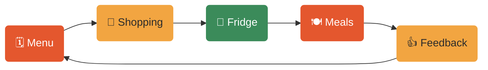

<p align="right">
  <a href="README.fr.md"></a>
</p>

<p align="center">
  <picture>
    <source media="(prefers-color-scheme: dark)" srcset="docs/media/banner-dark.svg">
    
  </picture>
</p>

<h3 align="center">Your week of meals, planned in five minutes.</h3>

<p align="center">
  Claude plans your menu, writes your shopping list, keeps track of what is left in the fridge,<br>
  and learns what your household likes. Everything lives in your own Notion.
</p>

<p align="center">
  <a href="https://github.com/RandomFab/meal-planner/releases/latest/download/meal-planner.zip"></a>
  <a href="#install"></a>
  <a href="#your-first-try"></a>
</p>

<!-- Optional demo GIF (standard 07): uncomment once docs/media/demo.gif exists.
<p align="center">
  
</p>
-->

---

## What it does for you

- 🗓️ **Plans your week.** A full menu, built from the dishes you love, what is in season and what is already in the fridge.
- 🛒 **Writes your shopping list.** Quantities calculated from the recipes, minus what you already have, sorted by shop.
- ☀️ **Tells you what's for dinner.** Every morning: today's dishes, how long they take, and what to take out of the freezer for tomorrow.
- 👍 **Learns from you.** Tell it "too spicy" or "loved it", and the next menu takes it into account.
- 🔄 **Adapts when plans change.** "We're eating out on Thursday": it reshuffles the week and asks before changing anything.

## The week, on a loop



Each week builds on the last: what you loved comes back, what you didn't shows up less.

## Is it for you?

| ✅ It's for you if… | ❌ It's not for you if… |
| --- | --- |
| You cook at home most days of the week | You want calorie counting or a diet plan |
| You're tired of deciding "what's for dinner" every evening | You never plan more than a day ahead |
| You already use Notion, or are happy to try it (it's free) | You don't want your recipes stored in Notion |

## Before you start

- [ ] A **Claude** account, on [claude.ai](https://claude.ai) or the Claude desktop app. The free plan is enough; the automatic morning brief needs a paid plan (Pro or above).
- [ ] A free **Notion** account, on [notion.so](https://www.notion.so)
- [ ] About **10 minutes**

## Install

### 1️⃣ Copy the Notion template

Open the [Meal Planner template](https://example.com/notion-template) <!-- TODO: real template link --> and click **Duplicate**, top right. You now have your own copy, with a few example dishes to start with.

### 2️⃣ Connect Notion to Claude

In Claude, open **Settings → Connectors**, find **Notion** and click **Connect**. When Notion asks which pages Claude may use, select **Meal Planner**.

> [!NOTE]
> Notion shows a screen asking you to allow access. This is normal: it lets Claude read and update your Meal Planner pages, and nothing else.

### 3️⃣ Turn on file creation

Open **Settings → Capabilities** and switch on **Create and edit files**. Claude needs it to use skills.

### 4️⃣ Add Meal Planner to Claude

[Download meal-planner.zip](https://github.com/RandomFab/meal-planner/releases/latest/download/meal-planner.zip). Then open **Customize → Skills**, click **+**, choose **Upload a skill** and select the file. Don't unzip it.

> [!TIP]
> Use this link, not GitHub's green **Code** button: that one downloads files Claude can't read.

### 5️⃣ Schedule the morning brief <sup>optional</sup>

In a new conversation, write:

```text
Every day at 10 am, send me today's meal brief.
```

Claude proposes a task with its name, time and instructions. Check it, then click **Schedule**. You'll find it later under **Scheduled** in the left sidebar, to change the time or pause it.

> [!NOTE]
> The task runs even when your computer is off. It needs a paid plan (Pro or above).

<!-- Optional install GIF (standard 07): uncomment once docs/media/install.gif exists.
<details>
<summary>🎬 <b>Watch the whole install (45 seconds)</b></summary>
<br>

</details>
-->

<details>
<summary>Using Claude Code instead?</summary>
<br>

Run `/plugin install meal-planner@claude-plugins` <!-- TODO: confirm marketplace name -->. Details in [docs/developers.md](docs/developers.md).
</details>

## Your first try

Open a new conversation in Claude and type:

```text
Set up my meal planner
```

Claude asks you a few questions (how many people, which shops, which day you do your shopping), then links itself to your Notion copy. Then try:

```text
Plan next week's meals
```

You get a menu to review. Nothing is written to Notion until you say it's fine.

## Everyday use

| You say… | Claude… |
| --- | --- |
| 🗓️ "Plan next week's meals" | Proposes seven days of meals, then saves them to Notion once you agree |
| 🛒 "Make the shopping list" | Lists what to buy for the week, by shop, without what you already have |
| ☀️ "What's for dinner?" | Gives today's dishes, prep time and what to prepare for tomorrow |
| 📸 *A photo of a recipe* | Adds the dish and its ingredients to your recipe book |
| 🔄 "We're eating out on Thursday" | Moves or removes Thursday's dish, after asking you |
| 👎 "The curry was too spicy" | Remembers it, and suggests that dish less often |
| 🥕 "We're out of cream" | Updates what's left, and suggests a fix for the dishes that needed it |

## Make it yours

Change these at any time by just telling Claude, for example "We are now 3 people".

| Setting | Default | Example |
| --- | --- | --- |
| 👥 People in the household | 2 | "We are 4, including two kids" |
| 📅 First day of the week | Monday | "Our week starts on Tuesday" |
| 🏪 Shops | One supermarket | "A supermarket and a market stall" |
| 🛍️ Shopping day | Saturday | "We shop on Monday" |
| ⏰ Morning brief time | 10:00 | "Send the brief at 8 am" |

## Privacy & safety

> [!IMPORTANT]
> **Your data stays in your Notion.** Meal Planner doesn't send anything anywhere else.

- ✋ **It asks before writing.** Every change to your Notion is shown to you first.
- 🔍 **It only touches the Meal Planner pages** you shared with Claude in step 2.
- 📖 **Nothing hidden.** Everything Claude follows is written in plain text in this project. Feel free to read it.

## Questions

<details>
<summary><b>Do I need a paid Claude plan?</b></summary>
<br>
No, Meal Planner works on the free plan. Only the automatic morning brief (step 5) needs a paid plan. Without it, just ask "What's for dinner today?".
</details>

<details>
<summary><b>Claude says it can't find my Notion pages.</b></summary>
<br>
Go back to <b>Settings → Connectors → Notion</b> and check that the <b>Meal Planner</b> page is shared with Claude.
</details>

<details>
<summary><b>"Upload a skill" is missing.</b></summary>
<br>
Check that <b>Create and edit files</b> is on (step 3). On a work account, your administrator may have turned skills off.
</details>

<details>
<summary><b>The morning brief doesn't arrive.</b></summary>
<br>
Open <b>Scheduled</b> in the left sidebar and check that the task isn't paused. Also check that the Notion connector is still active.
</details>

<details>
<summary><b>Can I use it in another language?</b></summary>
<br>
Yes. Claude answers in the language you write in.
</details>

<details>
<summary><b>How do I update to a new version?</b></summary>
<br>
Download the file again and upload it in <b>Customize → Skills</b>. It replaces the old one. Your Notion data is untouched.
</details>

---

<p align="center">
  Made by <a href="https://github.com/RandomFab"><b>RandomFab</b></a> · <a href="https://fabienbardouil.com">Portfolio</a><br>
  If Meal Planner saves you time, a ⭐ on this page helps others find it.<br>
  <sub><a href="docs/developers.md">For developers</a> · <a href="CHANGELOG.md">What's new</a> · <a href="LICENSE">MIT License</a></sub>
</p>
